# Widgets App

Aplicación de ejemplo desarrollada con Flutter y Material 3. Reúne pantallas interactivas para explorar widgets, controles, navegación, animaciones y manejo de estado.

## Funcionalidades

- **Menú principal:** acceso a las demostraciones desde una lista y un menú lateral.
- **Contador con Riverpod:** contador inicializado en 5 que aumenta al pulsar el botón flotante.
- **Botones:** ejemplos de botones Elevated, Filled, Outlined, Text, botones con icono, deshabilitados y un botón personalizado.
- **Tarjetas:** tarjetas con distintos estilos, bordes, colores y niveles de elevación; algunas muestran imágenes de Internet.
- **Indicadores de progreso:** indicadores circulares y lineales, tanto indeterminados como controlados.
- **Snackbars y diálogos:** demostración de un diálogo de confirmación, un snackbar con acción y la información de licencias.
- **Animated Container:** cambia de forma, tamaño y color con una transición animada al tocar el botón flotante.
- **Controles de interfaz:** switch, opciones de transporte con radio buttons, casillas de verificación y secciones expandibles.
- **Tutorial introductorio:** presentación de varias páginas que permite salir o comenzar al llegar al final.
- **Lista infinita:** carga más imágenes al desplazarse y permite actualizar la lista con pull to refresh.
- **Cambio de tema:** selección de color principal y alternancia entre modo claro y oscuro.

## Requisitos

- Flutter y Dart instalados y configurados.
- Conexión a Internet para cargar imágenes remotas en las tarjetas y la lista infinita.

## Ejecución

Desde la carpeta `widgets_app/`, instala las dependencias y ejecuta la aplicación:

```sh
flutter pub get
flutter run
```

## Tecnologías y organización

- **Flutter y Material 3:** construcción de la interfaz y componentes visuales.
- **GoRouter:** navegación entre las pantallas de ejemplo.
- **Riverpod:** estado del contador y configuración del tema.
- **animate_do:** animaciones de entrada usadas en el tutorial y la lista infinita.

La aplicación inicia en `widgets_app/lib/main.dart`. Las rutas están declaradas en `widgets_app/lib/config/router/app_router.dart`, las opciones del menú en `widgets_app/lib/config/menu/menu_items.dart` y las pantallas en `widgets_app/lib/presentation/screens/`.

## Diagrama de arquitectura

El diagrama muestra la estructura de `widgets_app`: el punto de entrada, el enrutamiento, las pantallas, el estado con Riverpod, el tema y los recursos externos.

[Abrir diagrama de arquitectura](https://diegomiguel04.github.io/Practicas_DMI_230260/Practica05/arquitectura/)

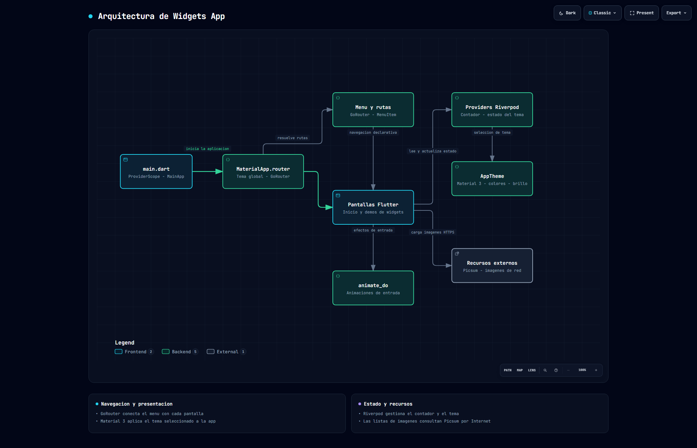

## Evidencias

**Inicio y navegación**

| Pantalla principal | Menú lateral |
|---|---|
| 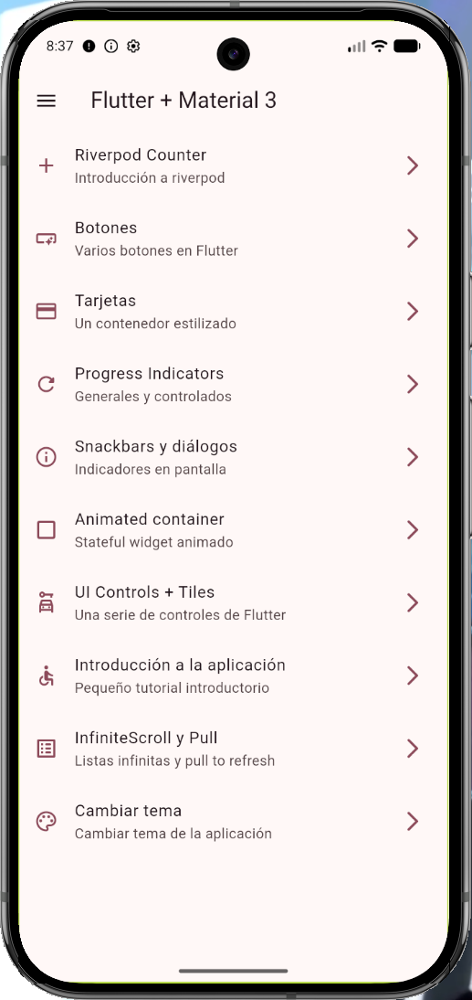 | 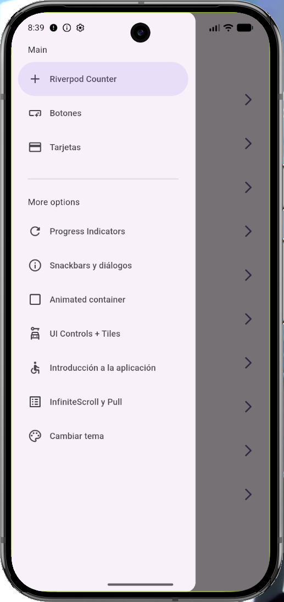 |

**Widgets y componentes**

| Botones | Tarjetas | Indicadores de progreso |
|---|---|---|
| 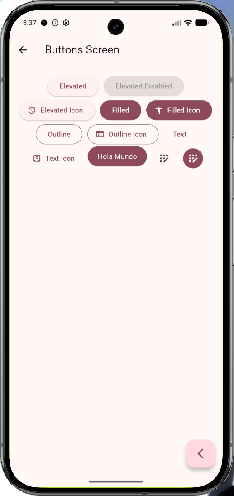 | 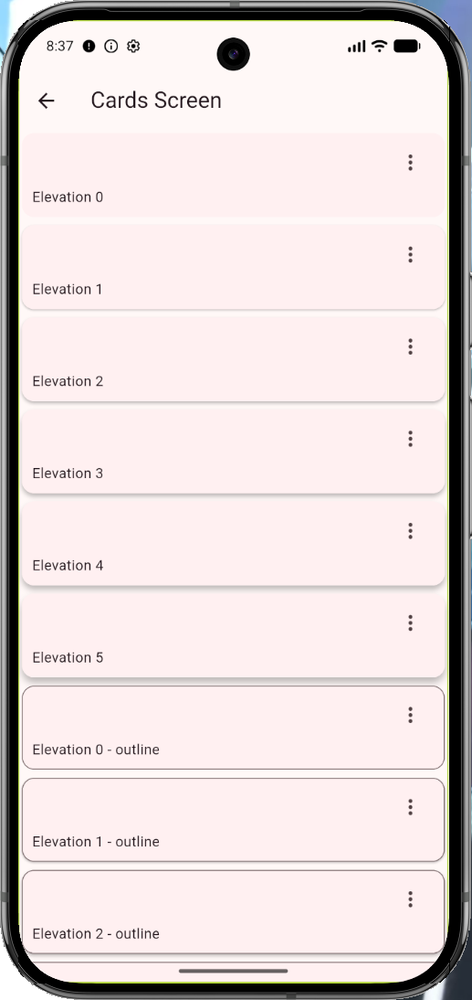 | 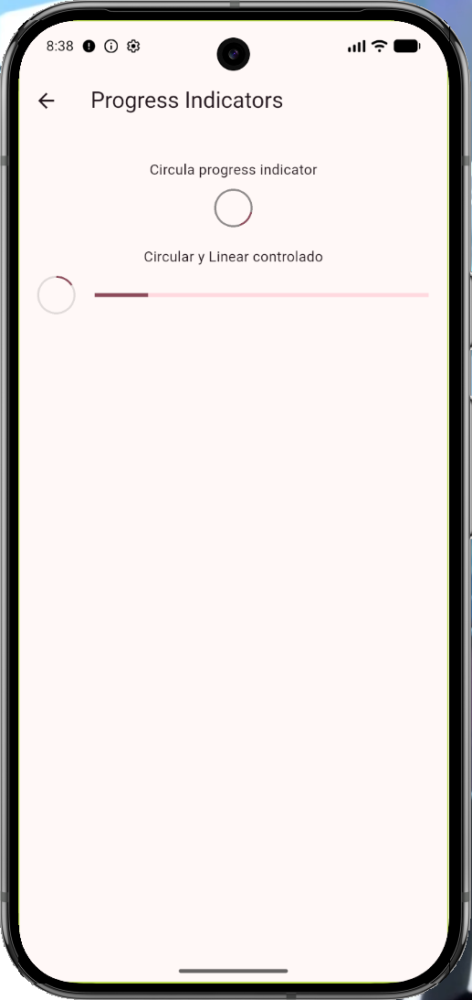 |

| Snackbars y diálogos | Controles de interfaz | Contenedor animado |
|---|---|---|
| 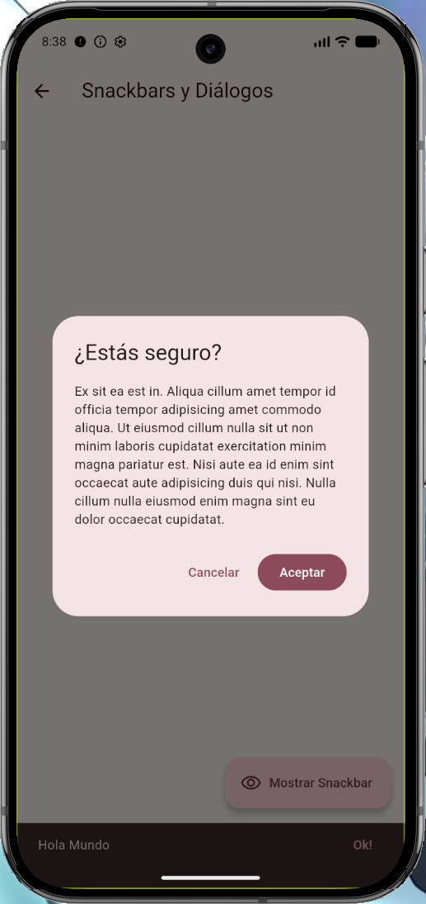 | 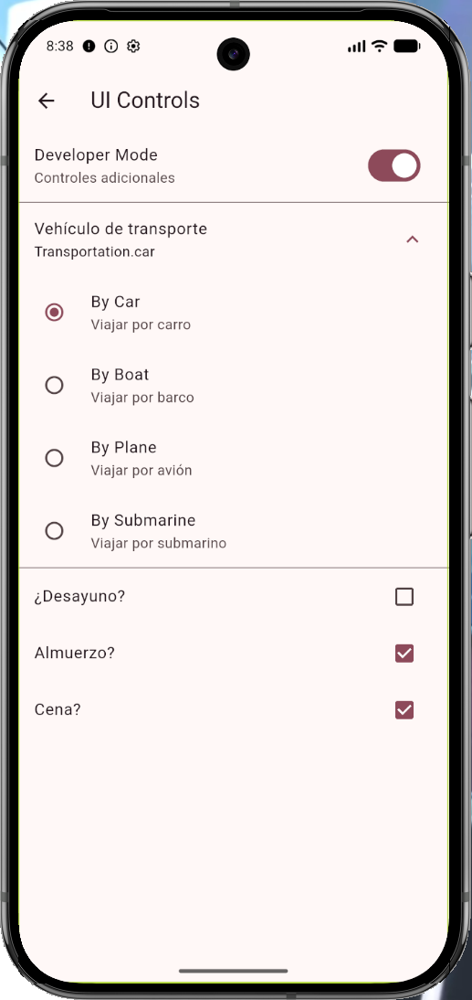 | 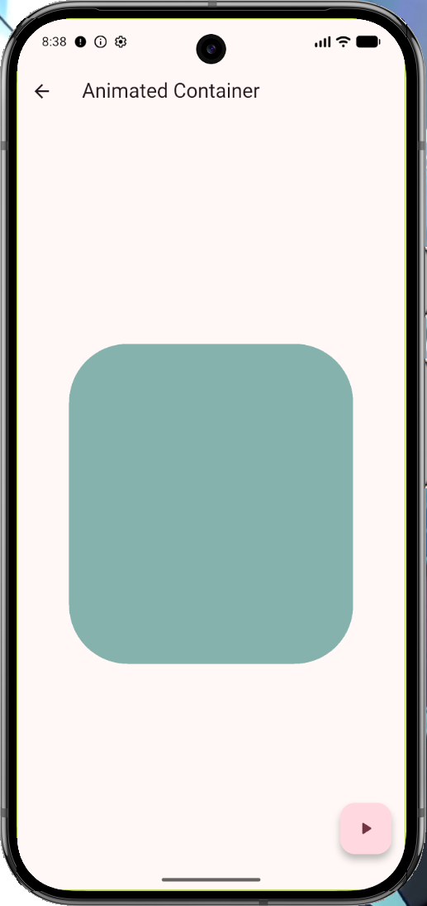 |

**Estado y temas**

| Contador con Riverpod | Selector de tema |
|---|---|
| 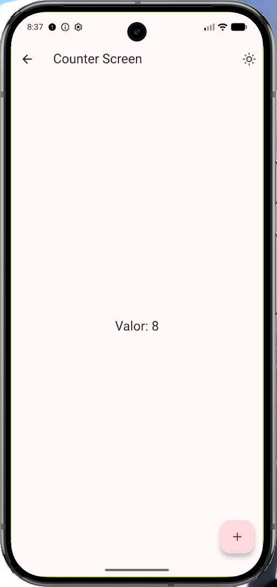 | 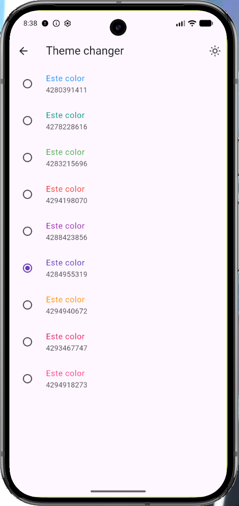 |
