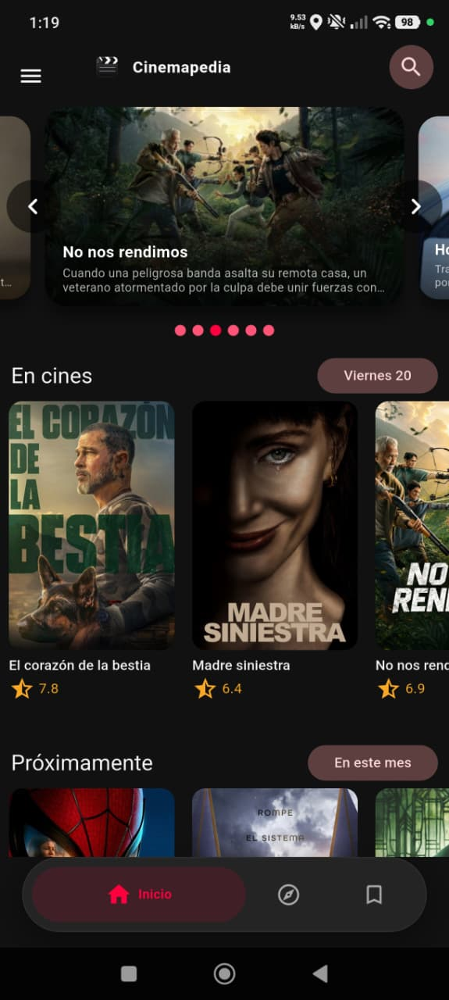
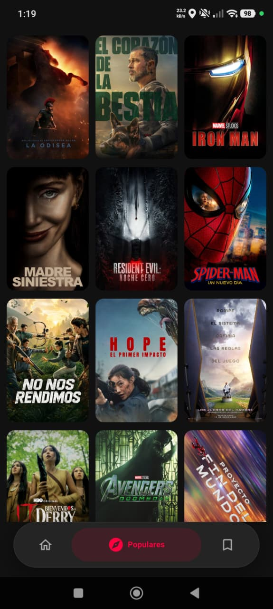
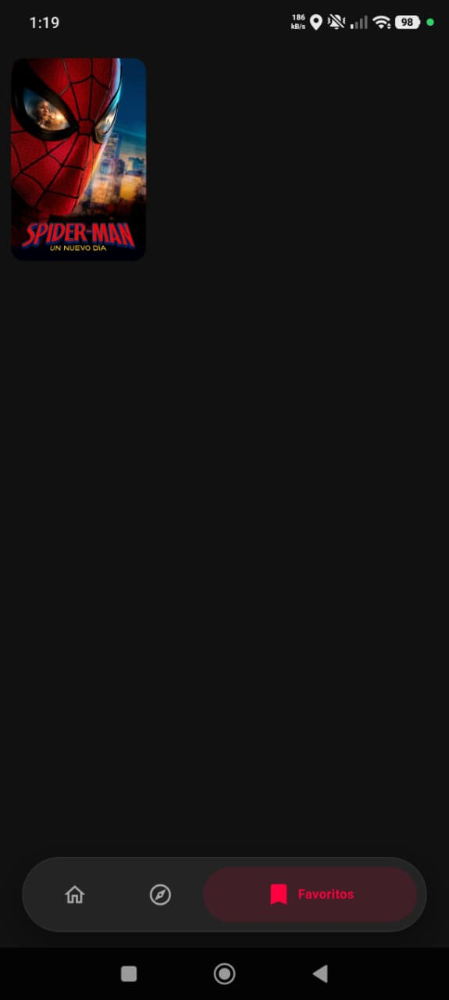
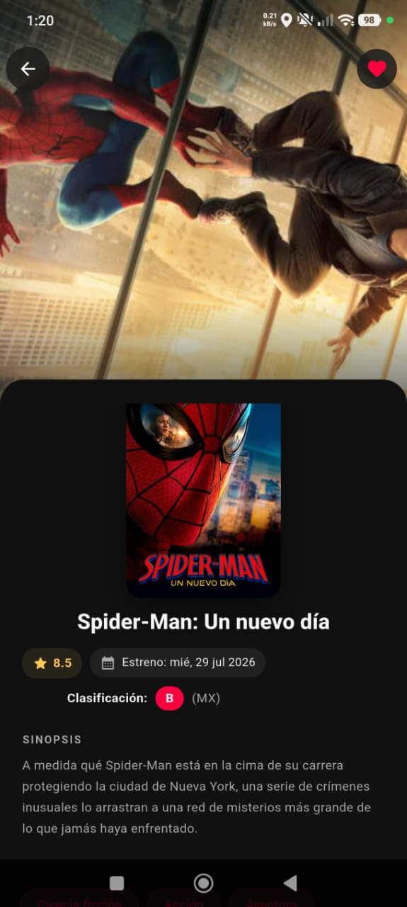
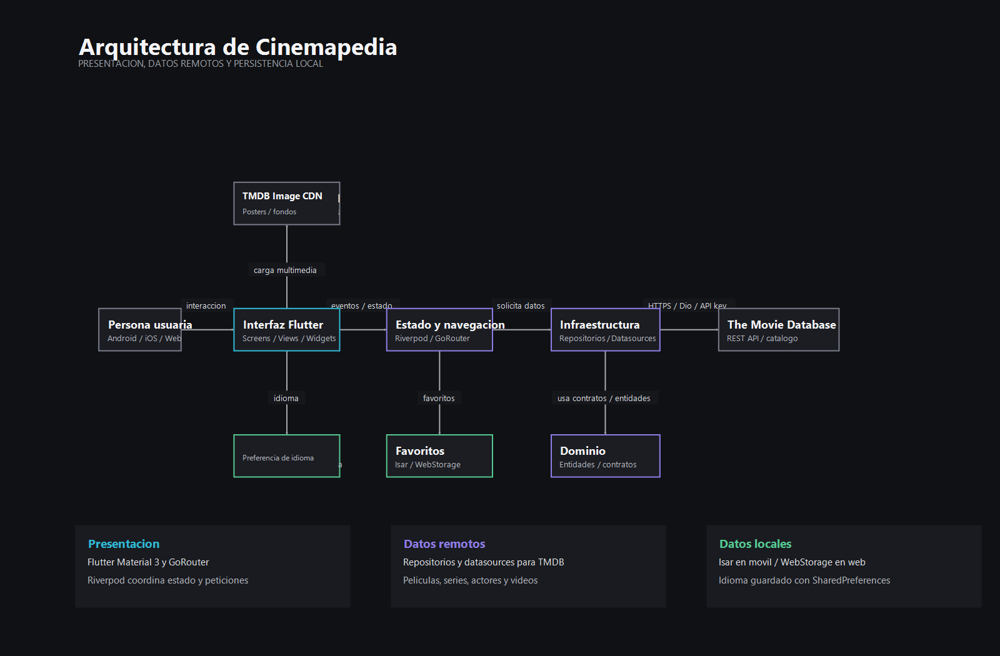

# Cinemapedia
Cinemapedia es una aplicación multiplataforma hecha con Flutter para descubrir películas y series. Ofrece catálogos, búsquedas, detalles, reparto, videos relacionados y favoritos locales. El idioma predeterminado es español; también se puede cambiar el idioma y el tipo de catálogo.

## Capturas de pantalla de la app

|||||
|---|---|---|---|
|Inicio|Populares|Favoritos|Detalle|


## Funcionalidades

- Catálogos de películas y series: en emisión/estreno, próximos, populares y mejor valorados.
- Búsqueda de películas y series.
- Detalle con sinopsis, fecha, valoración, clasificación por edad, reparto, videos y títulos similares.
- Favoritos persistentes en el dispositivo.
- Selector de idioma; el idioma elegido también se usa en las solicitudes a TMDB.
- Navegación por pestañas, transiciones animadas y tema oscuro.

## Arquitectura y organización

El proyecto sigue una separación por capas:

- `lib/presentation/`: pantallas, vistas, widgets, búsqueda y providers de Riverpod. GoRouter administra las rutas.
- `lib/domain/`: entidades y contratos abstractos de repositorios y datasources.
- `lib/infrastructure/`: implementaciones de repositorios, acceso a TMDB, persistencia local, modelos JSON y mappers.
- `lib/config/`: tema, rutas, idiomas, textos, constantes y helpers.
- `assets/`: recursos visuales, iconos y animaciones.
- `android/`, `ios/`, `web/`, `windows/`, `linux/`, `macos/`: configuración multiplataforma de Flutter.

Riverpod conecta la interfaz con los repositorios. Dio consulta The Movie Database (TMDB); los pósteres y fondos se cargan desde su CDN de imágenes. Películas y series comparten la entidad `Movie`; los identificadores negativos representan series.

Los favoritos se guardan con Isar en plataformas nativas y con WebStorage respaldado por SharedPreferences en web. SharedPreferences también conserva preferencias como el idioma.

## Appetize
[Ir a la simulacion en Appetize](https://appetize.io/app/b_khh5z6srvjt3fwi6yddqvi5xbe)

## Diagrama de arquitectura

[Abrir diagrama de arquitectura](https://diegomiguel04.github.io/Practicas_DMI_230260/Practica06/arquitectura/)



## APK de la App
[Ir al APK de la aplicación](https://diegomiguel04.github.io/Practicas_DMI_230260/Practica06/app-release.apk)

## Requisitos

- Flutter SDK compatible con Dart `^3.10.0` (ver `environment` en `pubspec.yaml`).
- Emulador/dispositivo Android o iOS, o navegador compatible para web.
- Clave de API de TMDB.

Comprueba la instalación:

```powershell
flutter doctor
```

## Configuración

1. Abre una terminal en la raíz del proyecto.
2. Crea `.env` a partir de la plantilla:

   ```powershell
   Copy-Item .env.template .env
   ```

3. Coloca tu clave en `.env`:

   ```env
   THE_MOVIEDB_KEY=tu_clave_de_tmdb
   ```

4. Instala dependencias:

   ```powershell
   flutter pub get
   ```

La clave se usa para consultar catálogos, detalles, reparto, clasificaciones por edad y videos. No publiques una clave privada en un repositorio público.

## Ejecutar

Con un emulador o dispositivo conectado:

```powershell
flutter run
```

Lista de dispositivos:

```powershell
flutter devices
```

Para ejecutar en un destino concreto, usa `flutter run -d <id-del-dispositivo>`. Para web, selecciona Chrome en la lista y ejecuta `flutter run -d chrome`.

## Compilar Android

APK de depuración:

```powershell
flutter build apk --debug
```

APK de distribución:

```powershell
flutter build apk --release
```

## Dependencias principales

- `flutter_riverpod`: estado de la interfaz.
- `go_router`: navegación.
- `dio`: peticiones HTTP a TMDB.
- `isar_community`: persistencia local nativa.
- `shared_preferences`: preferencias y almacenamiento web.
- `animate_do` y `card_swiper`: animaciones y carrusel.
- `youtube_player_flutter`: reproducción de videos.

Las versiones completas están en `pubspec.yaml` y `pubspec.lock`.

## Solución de problemas

- **Catálogo vacío o error de conexión:** confirma que `.env` existe en la raíz y contiene una clave válida de TMDB.
- **Flutter no detecta el dispositivo:** revisa `flutter doctor`, `flutter devices` y que el emulador esté iniciado.
- **Cambios de dependencias:** ejecuta `flutter pub get` y vuelve a iniciar la app.

## Información del proyecto

- Nombre: Cinemapedia
- Versión: `1.0.0`
- Framework: Flutter
- Fuente de datos: The Movie Database (TMDB)
